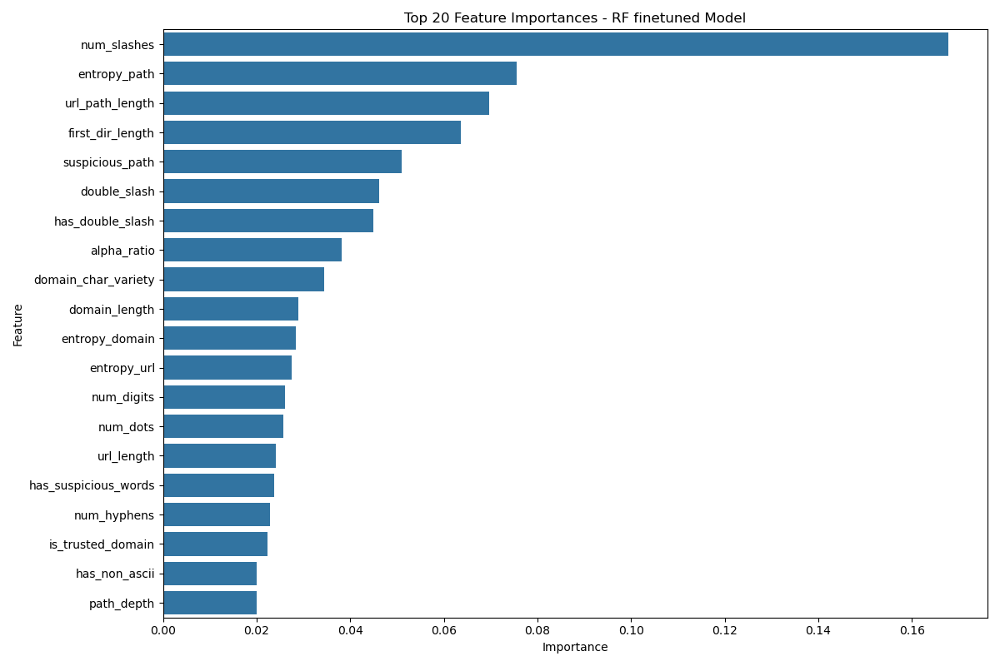
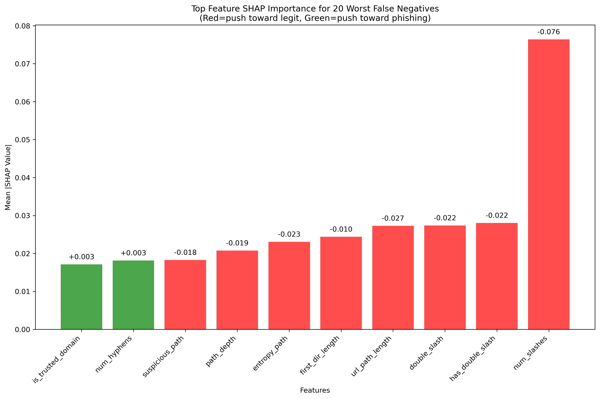

# Detection and Mitigation of Phishing Attacks on Social Networks

MSc dissertation project (Oxford Brookes University, 2025). A hybrid phishing detection system that combines **URL feature analysis** with **NLP classification**, evaluated with Random Forest, XGBoost and BERT, and wrapped in a simulated **SOC triage workflow** to measure how much analyst workload can be automated.

## Headline results

Best-performing configuration: fine-tuned Random Forest (`rf_test_finetuned.ipynb`).

| Metric | Result |
| --- | --- |
| Accuracy | over 98% |
| AUC | 0.9838 |
| Phishing detection workflows automated (simulated SOC) | 85% |
| Analyst manual review load | under 15% |
| False negative rate (high-fidelity threats) | under 2% |

All figures above are reproduced in the output cells of `rf_test_finetuned.ipynb`.

## Approach

1. **Feature extraction** from URLs (lexical and structural features) and text content

2. **Model comparison**: Random Forest (reduced grid search and fine-tuned), XGBoost and BERT.

3. **Hybrid workflow**: RF and BERT predictions are merged (`workflow_test.ipynb`) so that confident cases are handled automatically and uncertain ones are escalated to a human analyst.

4. **SOC triage simulation**: measures the share of cases automated versus sent for manual review, and the false negative rate.

5. **Error analysis**: SHAP, partial dependence plots and per-feature distribution plots for false positives and false negatives, to understand why the models fail.

### Trade-off finding

The other models also reached around 98% automation, but left a higher human review workload than the fine-tuned Random Forest. Accuracy alone was not the selection criterion: the workload placed on analysts was weighed alongside it.

## Repository contents

| File | Purpose |
| --- | --- |
| `rf_test_finetuned.ipynb` | Fine-tuned Random Forest: headline results and SOC triage figures |
| `rf_test_reduced_grid.ipynb` | Random Forest with a reduced hyperparameter grid |
| `XGBoost_model.ipynb` | XGBoost model and evaluation |
| `BERT_test.ipynb` | BERT-based text classifier |
| `workflow_test.ipynb` | Hybrid RF + BERT workflow |
| `feature_extraction.py` | Shared URL feature extraction (single source of truth) |
| `rf_finetuned_feature_extraction.py` | Compatibility shim for the fine-tuned RF notebook |
| `reduced_grid_feature_extraction.py` | Compatibility shim for the reduced-grid RF notebook |
| `XGBoost_model_feature_extraction.py` | Compatibility shim for the XGBoost notebook |
| `results/` | Plots: feature importance, SHAP, PDP and error analysis per model |

## Results

Plots are grouped by model under `results/`:

| Folder | Model |
| --- | --- |
| `results/rf_finetuned/` | Fine-tuned Random Forest |
| `results/rf_reduced_grid/` | Reduced-grid Random Forest |
| `results/xgboost/` | XGBoost |

Each folder contains the global feature importance, SHAP and partial-dependence plots for false positives and false negatives, plus an `error_analysis/` sub-folder with per-feature distribution plots.





## Setup

```bash
pip install -r requirements.txt
```

The notebooks are saved with their outputs, so the metrics, plots and triage results can be read directly on GitHub without running anything.

The code was written and run on my local machine, so some cells contain file paths from that setup. The dataset and trained models are not included:

- **Dataset:** [https://www.kaggle.com/datasets/harisudhan411/phishing-and-legitimate-urls](https://www.kaggle.com/datasets/harisudhan411/phishing-and-legitimate-urls), [https://huggingface.co/datasets/zefang-liu/phishing-email-dataset](https://huggingface.co/datasets/zefang-liu/phishing-email-dataset), and PhishTank phishing dataset.

- **Trained models:** the serialised `.joblib` files and the fine-tuned BERT model folder are not included because of their size.

- **To re-run:** download the dataset, update the file paths at the top of each notebook to your own locations, and run `rf_test_finetuned.ipynb` and `BERT_test.ipynb` first. Then run `workflow_test.ipynb`, which loads both models to produce the hybrid results.

> The `load_trusted_domains()` helper accepts a path via the `TRUSTED_DOMAINS_PATH` environment variable (default `../datasets/trusted_domains.csv`).

## Tech stack

Python, scikit-learn, XGBoost, BERT (Hugging Face Transformers), SHAP, pandas, Jupyter.

## Author

Abdulsalam Ali | [LinkedIn](https://linkedin.com/in/Abdulsalam-m-ali) | [abdulsalam.m.a.ali@gmail.com](mailto:abdulsalam.m.a.ali@gmail.com)
